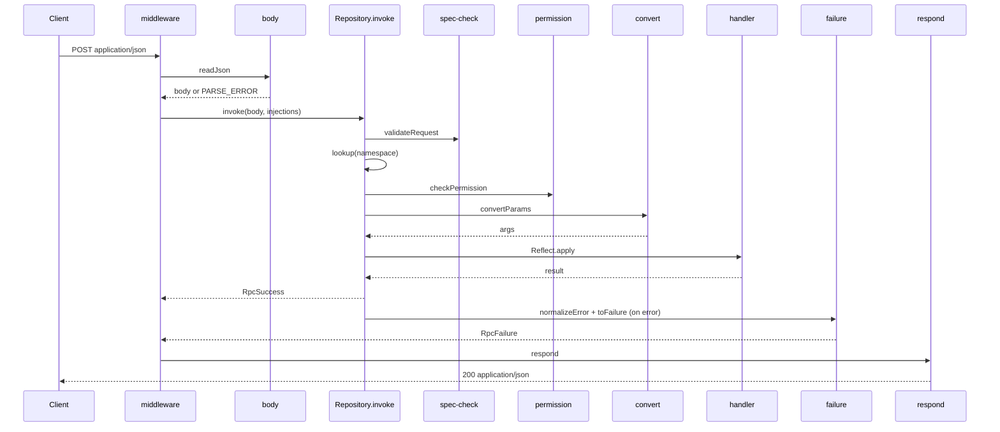
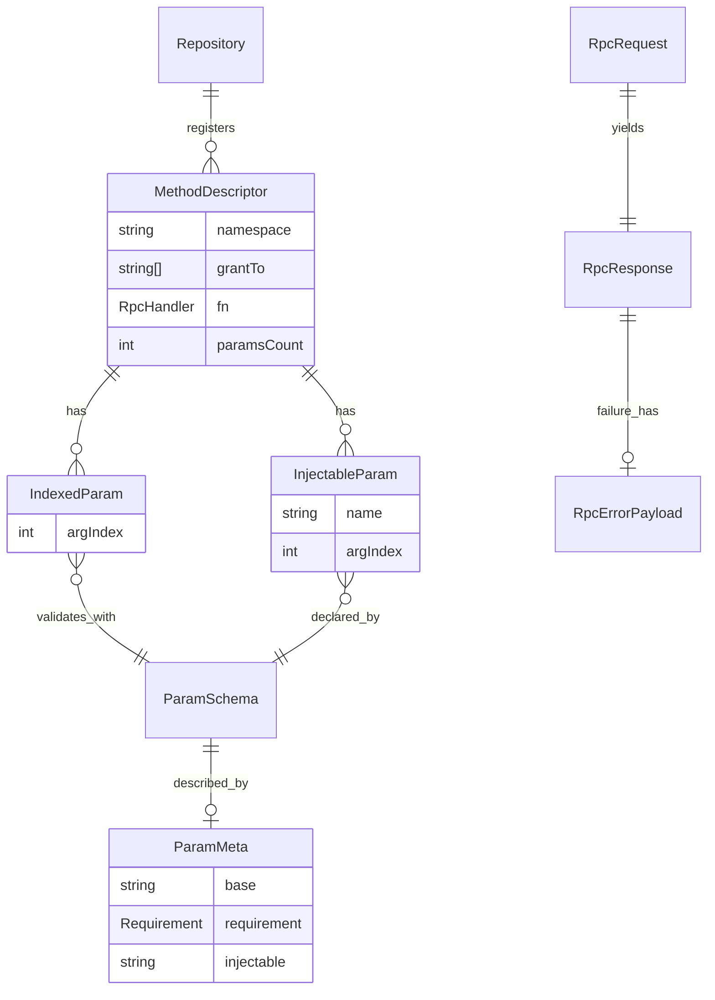

### 1. 需求理解与上下文确认

**当前意图**：先 review 现有代码，列出不合理的 Type 定义并给出修改建议，再 review 测试用例是否覆盖全部功能。已知 named 参数、notification、batch 三项是有意不支持的。你会本地手工应用并验证，我不在云端验证。

**已掌握**：完整目录、全部源码、tsconfig（`strict`、`exactOptionalPropertyTypes`、`noUncheckedIndexedAccess`）、测试与 vitest 配置、package.json。

**仍缺失（影响取舍，见第 8 节）**：
1. 公开 API 是否允许破坏性调整（`primitives.named`、`stringifySync`、`pipeStringify`、`InjectableFactory` 的导出位置）。
2. `grantTo` 方法在没有注入 `perm_check` 时，当前放行是否为有意的兼容行为。
3. `PERMISSION_DENIED = -32604` 是否必须保持。
4. 可选参数是否允许省略（当前 arity 严格相等）。
5. 函数值的 injectable 被自动惰性调用，这是否是需要保留的约定。

---

### 2. 现状分析与问题诊断

#### 2.1 Type 定义问题

| # | 位置 | 问题 | 建议 | 级别 |
|---|---|---|---|---|
| T1 | `types.ts` / `Repository.ts` | `InvokeOptions`、`RpcErrorTransform` 各定义两份，且 `\| undefined` 不一致，公开类型比实际能力更窄 | 只保留 `types.ts` 一份，字段显式写 `\| undefined` | P1 |
| T2 | `types.ts` / `schema/rpc.ts` | `RpcRequestInput` 与 `ParsedRequest` 重复。`id: JsonRpcId` 含 `null`，但 schema 拒绝 `null`，Repository 里靠 `as RpcRequestInput` 强转 | 以 `z.infer` 为唯一来源。引入 `RpcId = string \| number`，成功响应的 id 不含 null，失败响应是 `RpcId \| null` | P0 |
| T3 | `types.ts` | 值导入 `RpcError`，而 `RpcError.ts` 又导入 `types.ts`，形成运行时循环 | 改为 `import type` | P2 |
| T4 | `Injectables` | `unknown \| (() => …)` 会塌缩成 `unknown`，函数分支毫无作用。`perm_check` 没有类型，`permission.ts` 和 `convert.ts` 里到处强转 | 改为 `interface Injectables { perm_check?: PermCheck; [name: string]: unknown }`，并定义 `PermCheck` | P0 |
| T5 | `InjectableFactory` / `RepositoryLike` | `req: unknown, res: unknown`，调用方必须强转（测试里已经在强转）。`RepositoryLike` 没有存在意义 | 移到 express transport，使用 express 的 `Request`/`Response` 和 `Repository` | P1 |
| T6 | `RpcHandler` | `(...args: any[]) => unknown`，并且 `fn.apply(descriptor, …)` 隐式绑定 `this` | 改为 `(...args: never[]) => unknown`，调用用 `Reflect.apply` | P1 |
| T7 | `ParamSchema` | `z.ZodTypeAny` 在 Zod 4 里只是兼容别名，注释里的 "legacy adapter" 并不存在 | 改为 `z.ZodType` | P2 |
| T8 | `ParamMeta` / `HasMeta` | 扁平的可选字段加 `of?: unknown`。`arrayOf` 的 `of` 存字符串，`shape` 的 `of` 存 schema 对象，类型不一致。`kind` 只有 injectable 判断在用，其余只服务于永远不会触发的 `describe()` 回退。`required: 'none'` 与 `undefined` 语义重复。还通过 `as unknown as HasMeta` 向 zod 实例挂私有属性 | 收缩为 `{ base, requirement, injectable? }`，用 `WeakMap` 存储 | P0 |
| T9 | `required` / `requiredNotNull` / `named` / `setJSONString` | 原地修改入参，同一个 schema 实例被多个方法共享时，一处的 `required()` 会污染其他方法 | 先 `clone()` 再登记元数据（并入 T8） | P0 |
| T10 | `named()` / `naming` | 不支持 named 参数，这是死代码 | 删除（公开 API，需确认） | P2 |
| T11 | `primitiveSchema` / `voidSchema` | kind 含 `function`、`symbol`，JSON 参数不可能出现。`voidSchema()` 用 `z.undefined()`，`primitiveSchema('void')` 用 `z.void()`，不一致 | 收窄 kind，`voidSchema` 委托给 `primitiveSchema('void')` | P2 |
| T12 | `RpcDescriptor.sign` | "第 0 项是返回类型"只是隐式约定，靠运行时检查空数组 | 改为 `readonly [ParamSchema, ...ParamSchema[]]`，`grantTo` 也改 readonly | P1 |
| T13 | `descriptor.ts` | `originalIndex` 命名误导（实为 handler 实参下标）。`InjectableParam.schema` 未使用。`signatureOf` 与 `Repository.signatureOf` 重复。`invalidParams` 未使用。`MethodDescriptor` 字段非 readonly，并且被 `perm_check` 签名使用却没从 `index.ts` 导出 | 重命名为 `argIndex`，删除冗余，补导出 | P2 |
| T14 | 多处 | `convert.ts` 导出未使用的 `isPromiseLike`。`Repository.ts` 末尾有无意义的 `export type {…}`，`middleware.ts` 末尾同理。`system-methods.ts` 里的 `void required` 和 `debug/test.ts` 里的 `void (null as unknown as typeof RpcError)` 是"防 tree-shaking"hack | 全部删除并清理 import | P2 |
| T15 | `RpcError` | target 是 ES2022，`Object.setPrototypeOf` 多余 | 删除 | P2 |
| T16 | `respond` / `pipeStringify` | `payload: RpcResponse \| undefined` 的 `undefined` 分支是 notification 遗留。`res as unknown as NodeJS.WritableStream` 是双重强转 | 见 B1：直接移除 stream 模块 | P1 |
| T17 | `middleware.ts` `handleError` | 内联重复了 `RpcErrorTransform`。错误处理顺序是"先 transform 后 RpcError"，与 `Repository.invoke` 的"先 RpcError 后 transform"相反，payload 构造逻辑也重复了一份 | 抽出 `normalizeError` 和 `toFailure` | P1 |

**有意不改**：不用泛型从 `sign` 推导 handler 参数元组。这需要复杂的类型体操，收益有限，属于过度设计，由测试保证即可。

#### 2.2 review 过程中发现的功能缺陷（非类型，但必须先处理）

- **B1（P0）流式序列化会丢数据，且从未真正流式。** `walkStream` 在 `level > 0` 的递归调用里不 flush，缓冲区里不足 128KB 的叶子值直接丢失。`respond` 又先调用 `stringifySync` 完整序列化才判断是否走流式，流式毫无意义。generator 支持也因此永远不会生效。没有任何 `pipeStringify` 测试。**建议整体删除 `stream/`，用 `JSON.stringify`。**
- **B2（P0）`stringifySync` 产出非法 JSON。** 数组里的 `undefined` 输出为 `undefined` 记号，函数或 symbol 的属性会产出 `{"a":}`，另外不支持 `toJSON`、`BigInt`。`stringify.test.ts` 的 "keeps undefined in arrays" 把这个 bug 固化成了期望。
- **B3（P0）handler 返回 `undefined` 时响应既无 `result` 也无 `error`**（例如 `update`），违反 spec §5。应归一化为 `null`。
- **B4（P0，安全）`checkPermission` 在方法声明了 `grantTo` 却没有注入 `perm_check` 时直接放行**（fail-open）。应拒绝。
- **B5（P1）`convertParams` 丢弃 `safeParse` 的结果。** 把原始值传给 handler，zod 的 transform、default、coerce 全部失效。
- **B6（P1）可选参数无法省略。** arity 要求严格相等，`raw[j] === undefined` 的分支实际不可达（死代码）。
- **B7（P1）缺失 injectable 返回 `-32602`。** 这是服务端配置错误，应为 `-32603`。
- **B8（P1）`system.methodHelp` 无 doc 时返回 `null`。** 声明的返回类型和 doc 文本都说应返回空字符串。
- **B9（P1）named 参数当前得到 `-32600` 且 id 丢失。** 实际上信封合法，用 `-32602` 并回传 id 更贴近 spec。
- **B10（P1）package.json 问题。**
  - `main` 指向不存在的 `dist/index.cjs`。
  - `type-is` 是运行时依赖却没声明。
  - `express` 运行时使用却只在 devDependencies。
  - `body-parser` 与 `type-is` 在 Express 5 下都可以去掉，改用 `express.json()` 和 `req.is()`。
  - `files` 写的是 `src/public`，静态目录实际是 `htdoc`。
- **B11（P2）`PERMISSION_DENIED = -32604` 落在 spec 的保留段（-32768..-32000）内但未被定义。** 实现自定义错误应使用 -32000..-32099。
- **B12（P2）生产环境会剥离所有 `RpcError.data`，包括业务错误。** 应只对 `INTERNAL_ERROR` 脱敏（需确认）。
- **B13（P2）`src/debug/*` 与 `test/express/fixtures/*` 重复。**

#### 2.3 测试覆盖诊断

| 模块 | 现有 | 缺失 |
|---|---|---|
| spec-check / 协议 | 5 条零散用例 | 表驱动覆盖：notification、named、batch、`[]`、`[1,2,3]`、`jsonrpc:'1.0'`、method 为数字、id 为 null、id 为 boolean。断言成功响应无 `error`、失败响应无 `result` |
| descriptor | 无 | 空 namespace、sign 非法、injectable 在 0 位、injectable 无名、`grantTo` 非法、string 归一化 |
| convert | 4 条 | optional 省略、参数过多、null 与 required、zod 转换结果被使用、injectable 在中间位置、惰性 injectable、缺失 injectable |
| permission | 3 条 | 无 `perm_check` 时拒绝、返回 `RpcError`、`perm_check` 抛错、参数透传 |
| invoke | 2 条 | undefined→null、异步 reject、`RpcError` 不经 transform、生产环境 data 脱敏、id 回传 |
| primitives | 无 | 所有工厂的签名字符串、`parse` 行为、不修改入参（别名）、`oneOfType([])` 抛错 |
| system.* | 仅冒烟（只断言 `Array.isArray`） | 精确断言返回内容、未知方法 `-32601`、`methodHelp` 三种 doc |
| express | 5 条 | 非 JSON 透传、空 body、`bodyLimit`、默认 injectables、大响应、两种 `JsonRPC(...)` 入参形式 |
| stream | 3 条（只测了 `stringifySync`） | 直接删除模块，用 express 大响应测试代替 |
| index 公开 API | 无 | statics 与导出面 |
| 类型 | 无 | `*.test-d.ts` 保护新类型 |
| ws | 与 spec 完全重复，另有 skip 占位 | 删除，实现 ws 时再加 |

另外，`test/README.md` 提到的 `exts/` 目录不存在。`express.test.ts` 的 `buildApp(withGrant)` 重复造了 fixtures 里的 grant 方法，大量使用 `toMatchObject` 导致断言偏松，覆盖率阈值仍被注释掉。

---

### 3. 重构目标与分阶段策略

**目标**：类型单一来源且无 `any` 泄漏（保留的 `instanceOf` 边界除外）；修复 B1–B9；测试覆盖全部功能点。

**策略**：渐进式，每个 Phase 独立 commit，可单独回滚。

- **Phase 1（类型与核心）**：`types.ts`、`failure.ts`、`primitives.ts`、`descriptor.ts`、`convert.ts`、`permission.ts`、`Repository.ts`、`system-methods.ts`、`schema/rpc.ts`。这些文件互相依赖，一次应用，然后 `typecheck`。涉及 B2 之外的 B3–B9 行为变更。
- **Phase 2（transport 与打包）**：`respond.ts`、`body.ts`、`middleware.ts`、删除 `stream/` 与 `src/debug/`、`index.ts`、`package.json`。
- **Phase 3（测试）**：新增与改写测试，启用类型测试。

---

### 4. 架构设计方案

模块划分：

- `types` 与 `errors`：契约与错误。
- `schema`：zod 元数据登记与协议信封校验。
- `core`：`Repository`、`descriptor`、`convert`、`permission`、`system-methods`、`failure`。
- `transport/express`：`body`、`middleware`、`respond`。





---

### 5. 详细设计方案

关键决策：

1. **`types.ts` 是公共类型的唯一出口。** 请求类型从 `schema/rpc.ts` 的 zod schema 推导，不再手写第二份。
2. **元数据用 `WeakMap`，`required` 系列函数返回克隆。** 消除对 zod 实例的 monkey-patch 和别名污染。`ParamMeta` 只保留真正被消费的三个字段。
3. **错误出口收敛到 `normalizeError` + `toFailure`。** `Repository.invoke` 和 `middleware` 共用，顺序统一为"RpcError → transform → INTERNAL_ERROR"。
4. **`params` 在信封层放宽为 `unknown`。** named 参数交给 `convertParams`，返回 `-32602` 并保留 id。
5. **删除 `stream/`。** 用 `JSON.stringify`，序列化失败时返回带原 id 的 `-32603`。
6. **fail-closed 权限。** 有 `grantTo` 且无 `perm_check` 时拒绝。
7. **optional 参数可省略。** arity 改为"不得超过"。如要保持严格相等，保留原 `!==` 判断即可。

---

### 6. 重构代码

#### Phase 1

**src/types.ts**

```ts
import type { z } from 'zod';
import type { MethodDescriptor } from './core/descriptor';
import type { RpcError } from './errors/RpcError';

export type { ParsedRequest as RpcRequest } from './schema/rpc';

export type RpcId = string | number;

export interface RpcSuccess {
  jsonrpc: '2.0';
  id: RpcId;
  result: unknown;
}

export interface RpcErrorPayload {
  code: number;
  message: string;
  data?: unknown;
}

export interface RpcFailure {
  jsonrpc: '2.0';
  id: RpcId | null;
  error: RpcErrorPayload;
}

export type RpcResponse = RpcSuccess | RpcFailure;

export type ParamSchema = z.ZodType;

export type PermCheckResult = boolean | RpcError;

export type PermCheck = (
  grantTo: readonly string[],
  descriptor: MethodDescriptor,
) => PermCheckResult | Promise<PermCheckResult>;

export interface Injectables {
  perm_check?: PermCheck;
  [name: string]: unknown;
}

export type RpcDoc = string | (() => string | Promise<string>);

export interface RpcDescriptor {
  namespace: string;
  doc?: RpcDoc;
  grantTo?: string | readonly string[];
  sign: readonly [ParamSchema, ...ParamSchema[]];
}

export type RpcHandler = (...args: never[]) => unknown;

export type RpcErrorTransform = (error: unknown) => RpcError | undefined;

export interface InvokeOptions {
  injections?: Injectables | undefined;
  errorTransform?: RpcErrorTransform | undefined;
}
```

**src/schema/rpc.ts**（只改 `params` 一行）

```ts
import { z } from 'zod';

export const RequestSchema = z.object({
  jsonrpc: z.literal('2.0'),
  method: z.string().min(1),
  params: z.unknown().optional(),
  id: z.union([z.string(), z.number()]),
});

export type ParsedRequest = z.infer<typeof RequestSchema>;

export function formatIssues(error: z.ZodError): string {
  return error.issues
    .map((issue) => {
      const path = issue.path.length > 0 ? issue.path.join('.') : '(root)';
      return `${path}: ${issue.message}`;
    })
    .join('; ');
}
```

**src/errors/RpcError.ts**

```ts
import type { RpcErrorPayload } from '../types';

export class RpcError extends Error {
  readonly code: number;
  readonly data?: unknown;

  constructor(code: number, message: string, data?: unknown) {
    super(message);
    this.name = 'RpcError';
    this.code = code;
    if (data !== undefined) this.data = data;
  }

  toPayload(): RpcErrorPayload {
    const payload: RpcErrorPayload = { code: this.code, message: this.message };
    if (this.data !== undefined) payload.data = this.data;
    return payload;
  }

  toJSON(): RpcErrorPayload {
    return this.toPayload();
  }
}
```

**src/schema/primitives.ts**（`named` 已删除；`primitiveSchema` 的 kind 已收窄；`setJSONString` 现在返回克隆，调用方必须使用返回值）

```ts
import { z } from 'zod';
import type { ParamSchema } from '../types';

export type Requirement = 'optional' | 'required' | 'requiredNotNull';

export interface ParamMeta {
  readonly base: string;
  readonly requirement: Requirement;
  readonly injectable?: string;
}

const SUFFIX: Record<Requirement, string> = {
  optional: '',
  required: '.isRequired',
  requiredNotNull: '.isRequiredNotNull',
};

const DEFAULT_META: ParamMeta = { base: 'any', requirement: 'optional' };

const registry = new WeakMap<ParamSchema, ParamMeta>();

export function getMeta(schema: ParamSchema): ParamMeta {
  return registry.get(schema) ?? DEFAULT_META;
}

export function toJSONString(schema: ParamSchema): string {
  const meta = getMeta(schema);
  return meta.base + SUFFIX[meta.requirement];
}

function define(schema: ParamSchema, base: string, injectable?: string): ParamSchema {
  registry.set(
    schema,
    injectable === undefined
      ? { base, requirement: 'optional' }
      : { base, requirement: 'optional', injectable },
  );
  return schema;
}

function derive(schema: ParamSchema, patch: Partial<ParamMeta>): ParamSchema {
  const copy = schema.clone();
  registry.set(copy, { ...getMeta(schema), ...patch });
  return copy;
}

export function setJSONString(schema: ParamSchema, description: string): ParamSchema {
  return derive(schema, { base: description });
}

export function required(schema: ParamSchema): ParamSchema {
  return derive(schema, { requirement: 'required' });
}

export function requiredNotNull(schema: ParamSchema): ParamSchema {
  return derive(schema, { requirement: 'requiredNotNull' });
}

const PRIMITIVES = {
  string: () => z.string(),
  number: () => z.number(),
  boolean: () => z.boolean(),
  object: () => z.looseObject({}),
  array: () => z.array(z.any()),
  void: () => z.void(),
} as const;

export type PrimitiveKind = keyof typeof PRIMITIVES;

export function primitiveSchema(kind: PrimitiveKind): ParamSchema {
  return define(PRIMITIVES[kind](), kind);
}

export function voidSchema(): ParamSchema {
  return primitiveSchema('void');
}

export function anySchema(): ParamSchema {
  return define(z.any(), 'any');
}

export function injectableSchema(name: string): ParamSchema {
  return define(z.any(), `injectable:${name}`, name);
}

export function arrayOf(schema: ParamSchema): ParamSchema {
  return define(z.array(schema), `arrayOf(${toJSONString(schema)})`);
}

export function objectOf(schema: ParamSchema): ParamSchema {
  return define(z.record(z.string(), schema), `objectOf(${toJSONString(schema)})`);
}

export function oneOf<T extends readonly [string, ...string[]]>(values: T): ParamSchema {
  return define(z.enum(values), `oneOf(${JSON.stringify(values)})`);
}

export function oneOfType(schemas: readonly ParamSchema[]): ParamSchema {
  const [first, second, ...rest] = schemas;
  if (first === undefined) {
    throw new Error('oneOfType requires at least one schema.');
  }
  const union = second === undefined ? first.clone() : z.union([first, second, ...rest]);
  return define(union, `oneOfType(${JSON.stringify(schemas.map((item) => toJSONString(item)))})`);
}

export function shape<T extends Record<string, ParamSchema>>(fields: T): ParamSchema {
  const signature = JSON.stringify(
    Object.fromEntries(Object.entries(fields).map(([key, value]) => [key, toJSONString(value)])),
  );
  return define(z.object(fields), `shape(${signature})`);
}

export function instanceOf<T extends abstract new (...args: any[]) => any>(cls: T): ParamSchema {
  const schema = z.instanceof(cls as unknown as new (...args: any[]) => InstanceType<T>);
  return define(schema, `instanceOf(${cls.name || '<<anonymous>>'})`);
}
```

**src/core/descriptor.ts**

```ts
import { METHOD_NOT_FOUND } from '../errors/codes';
import { RpcError } from '../errors/RpcError';
import { getMeta, toJSONString } from '../schema/primitives';
import type { ParamSchema, RpcDescriptor, RpcDoc, RpcHandler } from '../types';

export interface IndexedParam {
  readonly schema: ParamSchema;
  readonly argIndex: number;
}

export interface InjectableParam {
  readonly name: string;
  readonly argIndex: number;
}

export interface MethodDescriptor {
  readonly namespace: string;
  readonly doc?: RpcDoc;
  readonly grantTo?: readonly string[];
  readonly fn: RpcHandler;
  readonly indexed: readonly IndexedParam[];
  readonly injectables: readonly InjectableParam[];
  readonly paramsCount: number;
  readonly signature: readonly ParamSchema[];
}

function normalizeGrantTo(grantTo: RpcDescriptor['grantTo']): readonly string[] | undefined {
  if (grantTo === undefined) return undefined;
  if (typeof grantTo === 'string') return [grantTo];
  if (!Array.isArray(grantTo)) {
    throw new Error('grantTo should be an array or string.');
  }
  if (!grantTo.every((item) => typeof item === 'string')) {
    throw new Error('grantTo should be an array of string.');
  }
  return [...grantTo];
}

export function buildDescriptor(descriptor: RpcDescriptor, fn: RpcHandler): MethodDescriptor {
  if (!descriptor.namespace) {
    throw new Error('please specify a namespace for this method.');
  }
  if (!Array.isArray(descriptor.sign)) {
    throw new Error('the sign should be a array of zod schemas.');
  }
  if (descriptor.sign.length === 0) {
    throw new Error('the sign should contain a return type as its first item.');
  }
  if (getMeta(descriptor.sign[0]).injectable !== undefined) {
    throw new Error('Invalid sign[0], the first signature could not be an injectable.');
  }

  const [, ...params] = descriptor.sign;
  const indexed: IndexedParam[] = [];
  const injectables: InjectableParam[] = [];

  params.forEach((schema, argIndex) => {
    const { injectable } = getMeta(schema);
    if (injectable === undefined) {
      indexed.push({ schema, argIndex });
    } else if (injectable === '') {
      throw new Error(`Invalid injectable at sign[${argIndex + 1}], missing injectable name.`);
    } else {
      injectables.push({ name: injectable, argIndex });
    }
  });

  const grantTo = normalizeGrantTo(descriptor.grantTo);

  return {
    namespace: descriptor.namespace,
    fn,
    indexed,
    injectables,
    paramsCount: params.length,
    signature: [...descriptor.sign],
    ...(descriptor.doc !== undefined && { doc: descriptor.doc }),
    ...(grantTo !== undefined && { grantTo }),
  };
}

export function signatureOf(descriptor: MethodDescriptor): string[] {
  return descriptor.signature.map((item) => toJSONString(item));
}

export function lookup(methods: ReadonlyMap<string, MethodDescriptor>, method: string): MethodDescriptor {
  const found = methods.get(method);
  if (!found) {
    throw new RpcError(METHOD_NOT_FOUND, 'Method not found', JSON.stringify(method));
  }
  return found;
}
```

**src/core/convert.ts**

```ts
import { INTERNAL_ERROR, INVALID_PARAMS } from '../errors/codes';
import { RpcError } from '../errors/RpcError';
import { getMeta } from '../schema/primitives';
import type { Injectables } from '../types';
import type { MethodDescriptor } from './descriptor';

function invalidParams(data: string): RpcError {
  return new RpcError(INVALID_PARAMS, 'Invalid params', data);
}

function toPositional(params: unknown): readonly unknown[] {
  if (params === undefined || params === null) return [];
  if (!Array.isArray(params)) {
    throw invalidParams('The parameters must be an array; named parameters are not supported.');
  }
  return params;
}

async function resolveInjectable(injections: Injectables, name: string): Promise<unknown> {
  if (!Object.hasOwn(injections, name)) {
    throw new RpcError(INTERNAL_ERROR, 'Internal error', `missing injectable [${name}]`);
  }
  const value = injections[name];
  return typeof value === 'function' ? await Reflect.apply(value, undefined, []) : value;
}

export async function convertParams(
  descriptor: MethodDescriptor,
  params: unknown,
  injections: Injectables,
): Promise<unknown[]> {
  const { namespace, indexed, injectables, paramsCount } = descriptor;
  const raw = toPositional(params);

  if (raw.length > indexed.length) {
    throw invalidParams(
      `Invalid parameters count. \`${raw.length}\` parameter(s) supplied to \`${namespace}\`, expected at most \`${indexed.length}\` parameter(s).`,
    );
  }

  const converted = new Array<unknown>(paramsCount);

  for (const injectable of injectables) {
    converted[injectable.argIndex] = await resolveInjectable(injections, injectable.name);
  }

  for (let i = 0; i < indexed.length; i++) {
    const { schema, argIndex } = indexed[i]!;
    const { requirement } = getMeta(schema);
    const value = raw[i];

    if (value === undefined) {
      if (requirement !== 'optional') {
        throw invalidParams(`Required parameter \`params[${i}]\` was not specified in \`${namespace}\`.`);
      }
      converted[argIndex] = undefined;
    } else if (value === null) {
      if (requirement === 'requiredNotNull') {
        throw invalidParams(`Required parameter \`params[${i}]\` was null in \`${namespace}\`.`);
      }
      converted[argIndex] = null;
    } else {
      const result = schema.safeParse(value);
      if (!result.success) {
        const reasons = result.error.issues.map((issue) => issue.message).join('; ');
        throw invalidParams(`Invalid parameter \`params[${i}]\` for \`${namespace}\`: ${reasons}`);
      }
      converted[argIndex] = result.data;
    }
  }

  return converted;
}
```

**src/core/permission.ts**

```ts
import { PERMISSION_DENIED } from '../errors/codes';
import { RpcError } from '../errors/RpcError';
import type { Injectables } from '../types';
import type { MethodDescriptor } from './descriptor';

export async function checkPermission(descriptor: MethodDescriptor, injections: Injectables): Promise<void> {
  const { grantTo } = descriptor;
  if (!grantTo || grantTo.length === 0) return;

  const denied = new RpcError(
    PERMISSION_DENIED,
    'Permission denied',
    `one of ${JSON.stringify(grantTo)} is necessary for [${descriptor.namespace}].`,
  );

  const permCheck = injections.perm_check;
  if (typeof permCheck !== 'function') throw denied;

  const result = await permCheck(grantTo, descriptor);
  if (result === true) return;
  throw result instanceof RpcError ? result : denied;
}
```

**src/core/failure.ts**（新增）

```ts
import { INTERNAL_ERROR } from '../errors/codes';
import { RpcError } from '../errors/RpcError';
import type { RpcErrorTransform, RpcFailure, RpcId } from '../types';

export function isProduction(): boolean {
  return process.env['NODE_ENV'] === 'production';
}

export function normalizeError(error: unknown, transform?: RpcErrorTransform): RpcError {
  if (error instanceof RpcError) return error;
  const transformed = transform?.(error);
  if (transformed) return transformed;
  const message = error instanceof Error ? error.message : String(error);
  if (!isProduction()) {
    console.error('Internal JSON-RPC error', message, error);
  }
  return new RpcError(INTERNAL_ERROR, 'Internal error', message);
}

export function toFailure(id: RpcId | null, error: RpcError): RpcFailure {
  const payload = error.toPayload();
  if (isProduction()) delete payload.data;
  return { jsonrpc: '2.0', id, error: payload };
}
```

**src/core/Repository.ts**

```ts
import { convertParams } from './convert';
import { buildDescriptor, lookup } from './descriptor';
import type { MethodDescriptor } from './descriptor';
import { normalizeError, toFailure } from './failure';
import { checkPermission } from './permission';
import { validateRequest } from './spec-check';
import { registerSystemMethods } from './system-methods';
import type { InvokeOptions, RpcDescriptor, RpcHandler, RpcId, RpcResponse } from '../types';

export interface RepositoryOptions {
  withSystemMethods?: boolean;
}

export class Repository {
  private readonly methods = new Map<string, MethodDescriptor>();

  constructor(options: RepositoryOptions = {}) {
    if (options.withSystemMethods !== false) {
      registerSystemMethods(this);
    }
  }

  register(descriptor: RpcDescriptor, fn: RpcHandler): void {
    const built = buildDescriptor(descriptor, fn);
    this.methods.set(built.namespace, built);
  }

  has(namespace: string): boolean {
    return this.methods.has(namespace);
  }

  list(): string[] {
    return [...this.methods.keys()];
  }

  get(namespace: string): MethodDescriptor | undefined {
    return this.methods.get(namespace);
  }

  async invoke(input: unknown, options: InvokeOptions = {}): Promise<RpcResponse> {
    const { injections = {}, errorTransform } = options;
    let id: RpcId | null = null;

    try {
      const request = validateRequest(input);
      id = request.id;
      const descriptor = lookup(this.methods, request.method);
      await checkPermission(descriptor, injections);
      const args = await convertParams(descriptor, request.params, injections);
      const result: unknown = await Reflect.apply(descriptor.fn, descriptor, args);
      return { jsonrpc: '2.0', id, result: result === undefined ? null : result };
    } catch (error) {
      return toFailure(id, normalizeError(error, errorTransform));
    }
  }
}

export function createRepository(options: RepositoryOptions = {}): Repository {
  return new Repository(options);
}
```

**src/core/system-methods.ts**（只列需要改的部分，保留你原有的 `doc` 字符串）

顶部 import 改为：

```ts
import { METHOD_NOT_FOUND } from '../errors/codes';
import { RpcError } from '../errors/RpcError';
import { arrayOf, primitiveSchema, requiredNotNull } from '../schema/primitives';
import { signatureOf } from './descriptor';
import type { MethodDescriptor } from './descriptor';
import type { Repository } from './Repository';

function requireDescriptor(repository: Repository, namespace: string): MethodDescriptor {
  const descriptor = repository.get(namespace);
  if (!descriptor) {
    throw new RpcError(METHOD_NOT_FOUND, 'Method not found', `Method not found.[${namespace}]`);
  }
  return descriptor;
}
```

`methodSignature` 和 `methodHelp` 的 handler 改为：

```ts
function systemMethodSignature(namespace: string) {
  return signatureOf(requireDescriptor(repository, namespace));
}

async function systemMethodHelp(namespace: string) {
  const { doc } = requireDescriptor(repository, namespace);
  if (doc === undefined) return '';
  return typeof doc === 'function' ? await doc() : doc;
}
```

删除 `import { required }` 和末尾的 `void required;`。

#### Phase 2

**src/transport/express/respond.ts**

```ts
import type { Response } from 'express';
import { INTERNAL_ERROR } from '../../errors/codes';
import type { RpcResponse } from '../../types';

function serialize(payload: RpcResponse): string {
  try {
    return JSON.stringify(payload);
  } catch (error) {
    console.error('Failed to stringify RPC response', error);
    return JSON.stringify({
      jsonrpc: '2.0',
      id: payload.id,
      error: { code: INTERNAL_ERROR, message: 'Internal error' },
    });
  }
}

export function respond(res: Response, payload: RpcResponse): void {
  res.status(200);
  res.setHeader('Cache-Control', 'no-cache');
  res.setHeader('Content-Type', 'application/json');
  res.end(serialize(payload));
}
```

**src/transport/express/body.ts**（`rawBody` 在整个仓库里没有使用，一并去掉）

```ts
import express from 'express';
import type { Request, RequestHandler, Response } from 'express';
import { PARSE_ERROR } from '../../errors/codes';
import { RpcError } from '../../errors/RpcError';

export interface ReadJsonOptions {
  limit?: string;
}

export function createJsonParser(options: ReadJsonOptions = {}): RequestHandler {
  return express.json({ limit: options.limit ?? '1mb' });
}

export function readJson(req: Request, res: Response, parser: RequestHandler): Promise<unknown> {
  return new Promise((resolve, reject) => {
    parser(req, res, (error?: unknown) => {
      if (error) {
        reject(new RpcError(PARSE_ERROR, 'Parse error', error instanceof Error ? error.message : String(error)));
        return;
      }
      resolve(req.body);
    });
  });
}
```

**src/transport/express/middleware.ts**

```ts
import path from 'node:path';
import { fileURLToPath } from 'node:url';
import express from 'express';
import type { Request, RequestHandler, Response, Router } from 'express';
import { Repository } from '../../core/Repository';
import { normalizeError, toFailure } from '../../core/failure';
import type { Injectables, RpcErrorTransform } from '../../types';
import { createJsonParser, readJson } from './body';
import { respond } from './respond';

export type InjectableFactory = (req: Request, res: Response, repository: Repository) => Injectables;

export interface JsonRpcOptions {
  repository?: Repository;
  mkInjectable?: InjectableFactory;
  errorTransform?: RpcErrorTransform;
  bodyLimit?: string;
  staticDir?: string;
}

const defaultStaticDir = path.resolve(path.dirname(fileURLToPath(import.meta.url)), '..', '..', '..', 'htdoc');

function defaultInjectables(req: Request, res: Response, repository: Repository): Injectables {
  return {
    request: req,
    session: (req as Request & { session?: unknown }).session,
    response: res,
    repository,
  };
}

export function JsonRPC(repositoryOrOptions: Repository | JsonRpcOptions): Router {
  const options: JsonRpcOptions =
    repositoryOrOptions instanceof Repository ? { repository: repositoryOrOptions } : repositoryOrOptions;
  const repository = options.repository ?? new Repository();
  const makeInjectables = options.mkInjectable ?? defaultInjectables;
  const jsonParser = createJsonParser({ limit: options.bodyLimit ?? '1mb' });
  const router = express.Router();

  const handler: RequestHandler = async (req, res, next) => {
    if (!req.is('application/json')) {
      next();
      return;
    }
    try {
      const input = await readJson(req, res, jsonParser);
      const output = await repository.invoke(input, {
        injections: makeInjectables(req, res, repository),
        errorTransform: options.errorTransform,
      });
      respond(res, output);
    } catch (error) {
      respond(res, toFailure(null, normalizeError(error, options.errorTransform)));
    }
  };

  router.post('/', handler);
  router.use(express.static(options.staticDir ?? defaultStaticDir));
  return router;
}
```

**src/transport/express/index.ts**

```ts
export { JsonRPC } from './middleware';
export type { InjectableFactory, JsonRpcOptions } from './middleware';
```

**src/index.ts**（改动点：删除 `stream` 导出，补充类型导出）

```ts
import { Repository, createRepository } from './core/Repository';
import { JsonRPC } from './transport/express';
import { RpcError } from './errors/RpcError';
import * as codes from './errors/codes';
import * as primitives from './schema/primitives';
import { z } from 'zod';

const JsonRPCWithStatics = Object.assign(JsonRPC, {
  Repository,
  createRepository,
  JsonRpcError: RpcError,
});

export { JsonRPCWithStatics as JsonRPC };
export { Repository, createRepository };
export { RpcError, RpcError as JsonRpcError };
export { codes };
export { primitives };
export { z };
export * from './types';
export type { InjectableFactory, JsonRpcOptions } from './transport/express';
export type { RepositoryOptions } from './core/Repository';
export type { MethodDescriptor } from './core/descriptor';

export default JsonRPCWithStatics;
```

**删除**：`src/stream/`、`test/unit/stream/`、`test/ws/`、`src/debug/`。`package.json` 的 `start` 改为 `tsx test/express/fixtures/server.ts`。

**package.json**（变更部分）

```json
{
  "main": "./dist/index.js",
  "files": ["dist", "htdoc"],
  "scripts": {
    "start": "tsx test/express/fixtures/server.ts"
  },
  "peerDependencies": {
    "express": "^5.0.0"
  },
  "dependencies": {
    "zod": "^4.6.7"
  }
}
```

同时从 `devDependencies` 删除 `@types/body-parser`、`@types/type-is`。`body-parser` 与 `type-is` 不再需要，`express` 保留在 devDependencies 供测试使用。`htdoc` 目录如果实际不存在，请同时去掉 `files` 里的这一项，以及 `express.static` 那一行。

#### Phase 3：测试

**test/unit/core/permission.test.ts**（整体替换）

```ts
import { describe, expect, it, vi } from 'vitest';
import { buildDescriptor } from '../../../src/core/descriptor';
import { checkPermission } from '../../../src/core/permission';
import { PERMISSION_DENIED } from '../../../src/errors/codes';
import { RpcError } from '../../../src/errors/RpcError';
import { primitiveSchema } from '../../../src/schema/primitives';
import type { PermCheck } from '../../../src/types';

const guarded = buildDescriptor(
  { namespace: 'secret', grantTo: ['admin', 'ops'], sign: [primitiveSchema('string')] },
  () => 'ok',
);
const open = buildDescriptor({ namespace: 'open', sign: [primitiveSchema('string')] }, () => 'ok');

describe('checkPermission', () => {
  it('allows methods without grantTo', async () => {
    await expect(checkPermission(open, {})).resolves.toBeUndefined();
  });

  it('denies when perm_check is missing', async () => {
    await expect(checkPermission(guarded, {})).rejects.toMatchObject({ code: PERMISSION_DENIED });
  });

  it('denies when perm_check returns false', async () => {
    await expect(checkPermission(guarded, { perm_check: async () => false })).rejects.toMatchObject({
      code: PERMISSION_DENIED,
    });
  });

  it('allows when perm_check returns true', async () => {
    await expect(checkPermission(guarded, { perm_check: async () => true })).resolves.toBeUndefined();
  });

  it('rethrows the RpcError returned by perm_check', async () => {
    const custom = new RpcError(-32001, 'Custom');
    await expect(checkPermission(guarded, { perm_check: async () => custom })).rejects.toBe(custom);
  });

  it('passes grantTo and descriptor to perm_check', async () => {
    const permCheck = vi.fn<PermCheck>(async () => true);
    await checkPermission(guarded, { perm_check: permCheck });
    expect(permCheck).toHaveBeenCalledWith(['admin', 'ops'], guarded);
  });

  it('propagates exceptions thrown by perm_check', async () => {
    const failing: PermCheck = () => {
      throw new Error('boom');
    };
    await expect(checkPermission(guarded, { perm_check: failing })).rejects.toThrow('boom');
  });
});
```

**test/unit/core/descriptor.test.ts**（新增）

```ts
import { describe, expect, it } from 'vitest';
import { buildDescriptor, lookup, signatureOf } from '../../../src/core/descriptor';
import { RpcError } from '../../../src/errors/RpcError';
import { METHOD_NOT_FOUND } from '../../../src/errors/codes';
import { injectableSchema, primitiveSchema, requiredNotNull } from '../../../src/schema/primitives';

const str = primitiveSchema('string');

describe('buildDescriptor', () => {
  it.each([
    [{ namespace: '', sign: [str] }, /namespace/],
    [{ namespace: 'a', sign: 'x' }, /array/],
    [{ namespace: 'a', sign: [] }, /return type/],
    [{ namespace: 'a', sign: [injectableSchema('x')] }, /Invalid sign\[0\]/],
    [{ namespace: 'a', sign: [str, injectableSchema('')] }, /missing injectable name/],
    [{ namespace: 'a', grantTo: 1, sign: [str] }, /grantTo/],
    [{ namespace: 'a', grantTo: [1], sign: [str] }, /grantTo/],
  ])('rejects %j', (input, message) => {
    expect(() => buildDescriptor(input as never, () => 1)).toThrow(message);
  });

  it('normalizes string grantTo to an array', () => {
    expect(buildDescriptor({ namespace: 'a', grantTo: 'admin', sign: [str] }, () => 1).grantTo).toEqual(['admin']);
  });

  it('maps handler argument positions around injectables', () => {
    const built = buildDescriptor(
      {
        namespace: 'mixed',
        sign: [str, requiredNotNull(str), injectableSchema('ctx'), requiredNotNull(str)],
      },
      () => 1,
    );
    expect(built.indexed.map((item) => item.argIndex)).toEqual([0, 2]);
    expect(built.injectables).toEqual([{ name: 'ctx', argIndex: 1 }]);
    expect(built.paramsCount).toBe(3);
  });

  it('exposes the signature strings', () => {
    const built = buildDescriptor({ namespace: 'a', sign: [str, requiredNotNull(str)] }, () => 1);
    expect(signatureOf(built)).toEqual(['string', 'string.isRequiredNotNull']);
  });
});

describe('lookup', () => {
  it('throws METHOD_NOT_FOUND for unknown methods', () => {
    expect(() => lookup(new Map(), 'nope')).toThrow(RpcError);
    expect(() => lookup(new Map(), 'nope')).toThrowError(expect.objectContaining({ code: METHOD_NOT_FOUND }));
  });
});
```

**test/unit/core/convert.test.ts**（整体替换）

```ts
import { describe, expect, it } from 'vitest';
import { z } from 'zod';
import { convertParams } from '../../../src/core/convert';
import { buildDescriptor } from '../../../src/core/descriptor';
import { INTERNAL_ERROR, INVALID_PARAMS } from '../../../src/errors/codes';
import { RpcError } from '../../../src/errors/RpcError';
import { injectableSchema, primitiveSchema, required, requiredNotNull } from '../../../src/schema/primitives';

const str = primitiveSchema('string');
const num = primitiveSchema('number');

const echo = buildDescriptor({ namespace: 'echo', sign: [str, requiredNotNull(str)] }, (value: string) => value);
const optional = buildDescriptor({ namespace: 'optional', sign: [str, str] }, (value?: string) => value);
const requiredOnly = buildDescriptor({ namespace: 'requiredOnly', sign: [str, required(str)] }, (value: string) => value);

describe('convertParams', () => {
  it('converts valid positional params', async () => {
    expect(await convertParams(echo, ['hello'], {})).toEqual(['hello']);
  });

  it('treats missing params as an empty list', async () => {
    expect(await convertParams(optional, undefined, {})).toEqual([undefined]);
    expect(await convertParams(optional, null, {})).toEqual([undefined]);
  });

  it('rejects named params', async () => {
    await expect(convertParams(echo, { value: 'x' }, {})).rejects.toMatchObject({ code: INVALID_PARAMS });
  });

  it('rejects too many params', async () => {
    await expect(convertParams(echo, ['a', 'b'], {})).rejects.toMatchObject({ code: INVALID_PARAMS });
  });

  it('rejects a missing required param', async () => {
    await expect(convertParams(echo, [], {})).rejects.toBeInstanceOf(RpcError);
    await expect(convertParams(echo, [], {})).rejects.toMatchObject({ code: INVALID_PARAMS });
    await expect(convertParams(requiredOnly, [], {})).rejects.toMatchObject({ code: INVALID_PARAMS });
  });

  it('accepts a missing optional param', async () => {
    expect(await convertParams(optional, [], {})).toEqual([undefined]);
  });

  it('distinguishes required from requiredNotNull for null', async () => {
    await expect(convertParams(echo, [null], {})).rejects.toMatchObject({ code: INVALID_PARAMS });
    expect(await convertParams(requiredOnly, [null], {})).toEqual([null]);
    expect(await convertParams(optional, [null], {})).toEqual([null]);
  });

  it('rejects values failing the schema', async () => {
    await expect(convertParams(echo, [1], {})).rejects.toMatchObject({ code: INVALID_PARAMS });
  });

  it('passes the parsed value to the handler', async () => {
    const upper = buildDescriptor(
      { namespace: 'upper', sign: [str, requiredNotNull(z.string().transform((value) => value.toUpperCase()))] },
      (value: string) => value,
    );
    expect(await convertParams(upper, ['abc'], {})).toEqual(['ABC']);
  });

  it('places injectables at their declared positions', async () => {
    const mixed = buildDescriptor(
      { namespace: 'mixed', sign: [str, requiredNotNull(num), injectableSchema('ctx'), requiredNotNull(str)] },
      () => null,
    );
    expect(await convertParams(mixed, [1, 'x'], { ctx: 'C' })).toEqual([1, 'C', 'x']);
  });

  it('resolves function injectables lazily', async () => {
    const withCtx = buildDescriptor({ namespace: 'lazy', sign: [str, injectableSchema('ctx')] }, () => null);
    expect(await convertParams(withCtx, [], { ctx: async () => 'C' })).toEqual(['C']);
  });

  it('reports a missing injectable as an internal error', async () => {
    const withCtx = buildDescriptor({ namespace: 'lazy', sign: [str, injectableSchema('ctx')] }, () => null);
    await expect(convertParams(withCtx, [], {})).rejects.toMatchObject({ code: INTERNAL_ERROR });
  });
});
```

**test/unit/core/invoke.test.ts**（整体替换）

```ts
import { afterEach, beforeEach, describe, expect, it, vi } from 'vitest';
import { Repository } from '../../../src/core/Repository';
import { RpcError } from '../../../src/errors/RpcError';
import { primitiveSchema } from '../../../src/schema/primitives';
import type { RpcErrorTransform } from '../../../src/types';

class Boom extends Error {}

function build(): Repository {
  const repo = new Repository({ withSystemMethods: false });
  repo.register({ namespace: 'boom', sign: [primitiveSchema('number')] }, () => {
    throw new Boom('kaboom');
  });
  repo.register({ namespace: 'rejects', sign: [primitiveSchema('number')] }, async () => {
    throw new Boom('async kaboom');
  });
  repo.register({ namespace: 'noop', sign: [primitiveSchema('void')] }, () => undefined);
  repo.register({ namespace: 'later', sign: [primitiveSchema('string')] }, async () => 'done');
  repo.register({ namespace: 'custom', sign: [primitiveSchema('number')] }, () => {
    throw new RpcError(-32001, 'Custom', { detail: 1 });
  });
  return repo;
}

const request = (method: string, id: string | number = 1) => ({ jsonrpc: '2.0', method, params: [], id });
const transformBoom: RpcErrorTransform = (error) =>
  error instanceof Boom ? new RpcError(-99999, 'Boom', error.message) : undefined;

describe('Repository.invoke', () => {
  beforeEach(() => {
    vi.spyOn(console, 'error').mockImplementation(() => undefined);
  });

  afterEach(() => {
    vi.restoreAllMocks();
    vi.unstubAllEnvs();
  });

  it('maps domain errors through errorTransform', async () => {
    const res = await build().invoke(request('boom'), { errorTransform: transformBoom });
    expect(res).toMatchObject({ id: 1, error: { code: -99999, message: 'Boom' } });
  });

  it('maps rejected promises through errorTransform', async () => {
    const res = await build().invoke(request('rejects'), { errorTransform: transformBoom });
    expect(res).toMatchObject({ id: 1, error: { code: -99999 } });
  });

  it('falls back to INTERNAL_ERROR when the transform misses', async () => {
    const res = await build().invoke(request('boom'));
    expect(res).toMatchObject({ id: 1, error: { code: -32603, message: 'Internal error' } });
  });

  it('does not run errorTransform for RpcError', async () => {
    const transform = vi.fn<RpcErrorTransform>(() => undefined);
    const res = await build().invoke(request('custom'), { errorTransform: transform });
    expect(transform).not.toHaveBeenCalled();
    expect(res).toMatchObject({ error: { code: -32001, message: 'Custom' } });
  });

  it('normalizes undefined results to null', async () => {
    expect(await build().invoke(request('noop'))).toEqual({ jsonrpc: '2.0', id: 1, result: null });
  });

  it('awaits async handlers', async () => {
    expect(await build().invoke(request('later'))).toEqual({ jsonrpc: '2.0', id: 1, result: 'done' });
  });

  it('echoes string ids on failure', async () => {
    const res = await build().invoke(request('missing', 'abc'));
    expect(res).toMatchObject({ id: 'abc', error: { code: -32601 } });
    expect(res).not.toHaveProperty('result');
  });

  it('exposes error data outside production', async () => {
    const res = await build().invoke(request('custom'));
    expect(res).toEqual({ jsonrpc: '2.0', id: 1, error: { code: -32001, message: 'Custom', data: { detail: 1 } } });
  });

  it('hides error data in production', async () => {
    vi.stubEnv('NODE_ENV', 'production');
    const res = await build().invoke(request('custom'));
    expect(res).toEqual({ jsonrpc: '2.0', id: 1, error: { code: -32001, message: 'Custom' } });
  });
});
```

**test/unit/schema/primitives.test.ts**（新增）

```ts
import { describe, expect, it } from 'vitest';
import { z } from 'zod';
import {
  arrayOf,
  getMeta,
  injectableSchema,
  instanceOf,
  objectOf,
  oneOf,
  oneOfType,
  primitiveSchema,
  required,
  requiredNotNull,
  setJSONString,
  shape,
  toJSONString,
} from '../../../src/schema/primitives';

describe('toJSONString', () => {
  it.each([
    [primitiveSchema('string'), 'string'],
    [primitiveSchema('void'), 'void'],
    [requiredNotNull(primitiveSchema('number')), 'number.isRequiredNotNull'],
    [required(primitiveSchema('boolean')), 'boolean.isRequired'],
    [arrayOf(requiredNotNull(primitiveSchema('string'))), 'arrayOf(string.isRequiredNotNull)'],
    [objectOf(primitiveSchema('number')), 'objectOf(number)'],
    [oneOf(['a', 'b']), 'oneOf(["a","b"])'],
    [oneOfType([primitiveSchema('string'), primitiveSchema('number')]), 'oneOfType(["string","number"])'],
    [shape({ a: primitiveSchema('string') }), 'shape({"a":"string"})'],
    [injectableSchema('request'), 'injectable:request'],
    [instanceOf(Date), 'instanceOf(Date)'],
    [setJSONString(primitiveSchema('string'), 'custom'), 'custom'],
    [z.array(z.number()), 'any'],
  ])('describes %#', (schema, expected) => {
    expect(toJSONString(schema)).toBe(expected);
  });
});

describe('requirement helpers', () => {
  it('never mutate the input schema', () => {
    const base = primitiveSchema('string');
    const strict = requiredNotNull(base);
    expect(strict).not.toBe(base);
    expect(getMeta(base).requirement).toBe('optional');
    expect(getMeta(strict).requirement).toBe('requiredNotNull');
  });

  it('replace the previous requirement instead of stacking', () => {
    expect(toJSONString(required(requiredNotNull(primitiveSchema('string'))))).toBe('string.isRequired');
  });

  it('keep a shared plain zod schema untouched', () => {
    const shared = z.string();
    required(shared);
    expect(getMeta(shared).requirement).toBe('optional');
  });
});

describe('schema behaviour', () => {
  it('validates containers', () => {
    expect(arrayOf(primitiveSchema('number')).safeParse([1, 'a']).success).toBe(false);
    expect(objectOf(primitiveSchema('number')).safeParse({ a: 'x' }).success).toBe(false);
    expect(oneOf(['a', 'b']).safeParse('c').success).toBe(false);
    expect(oneOfType([primitiveSchema('string'), primitiveSchema('number')]).safeParse(1).success).toBe(true);
    expect(shape({ a: primitiveSchema('string') }).safeParse({ a: 1 }).success).toBe(false);
    expect(instanceOf(Date).safeParse(new Date()).success).toBe(true);
  });

  it('requires at least one schema for oneOfType', () => {
    expect(() => oneOfType([])).toThrow();
  });

  it('does not mutate a lone oneOfType member', () => {
    const only = primitiveSchema('string');
    oneOfType([only]);
    expect(toJSONString(only)).toBe('string');
  });
});
```

**test/unit/core/system-methods.test.ts**（新增）

```ts
import { describe, expect, it } from 'vitest';
import { Repository } from '../../../src/core/Repository';
import { primitiveSchema, requiredNotNull } from '../../../src/schema/primitives';

function build(): Repository {
  const repo = new Repository();
  repo.register(
    { namespace: 'subtract', doc: 'subtract b from a', sign: [primitiveSchema('number'), requiredNotNull(primitiveSchema('number')), requiredNotNull(primitiveSchema('number'))] },
    (a: number, b: number) => a - b,
  );
  repo.register({ namespace: 'dynamic', doc: async () => 'dynamic help', sign: [primitiveSchema('void')] }, () => undefined);
  repo.register({ namespace: 'undocumented', sign: [primitiveSchema('void')] }, () => undefined);
  return repo;
}

const call = (repo: Repository, method: string, params: unknown[]) =>
  repo.invoke({ jsonrpc: '2.0', method, params, id: 1 });

describe('system methods', () => {
  it('lists every registered method', async () => {
    const res = await call(build(), 'system.listMethods', []);
    expect(res).toMatchObject({ result: expect.arrayContaining(['system.listMethods', 'system.methodSignature', 'system.methodHelp', 'subtract']) });
  });

  it('returns the signature of a method', async () => {
    const res = await call(build(), 'system.methodSignature', ['subtract']);
    expect(res).toEqual({ jsonrpc: '2.0', id: 1, result: ['number', 'number.isRequiredNotNull', 'number.isRequiredNotNull'] });
  });

  it('reports unknown methods', async () => {
    expect(await call(build(), 'system.methodSignature', ['nope'])).toMatchObject({ error: { code: -32601 } });
    expect(await call(build(), 'system.methodHelp', ['nope'])).toMatchObject({ error: { code: -32601 } });
  });

  it('requires the method name parameter', async () => {
    expect(await call(build(), 'system.methodHelp', [])).toMatchObject({ error: { code: -32602 } });
  });

  it('returns static, dynamic and empty help', async () => {
    const repo = build();
    expect(await call(repo, 'system.methodHelp', ['subtract'])).toMatchObject({ result: 'subtract b from a' });
    expect(await call(repo, 'system.methodHelp', ['dynamic'])).toMatchObject({ result: 'dynamic help' });
    expect(await call(repo, 'system.methodHelp', ['undocumented'])).toMatchObject({ result: '' });
  });

  it('can be disabled', () => {
    expect(new Repository({ withSystemMethods: false }).list()).toEqual([]);
  });
});
```

**test/spec/jsonrpc2.test.ts**（整体替换，把"有意不支持"的行为写成文档化的期望）

```ts
import { describe, expect, it } from 'vitest';
import { Repository } from '../../src/core/Repository';
import { installDebugMethods } from '../express/fixtures/test';

function build(): Repository {
  const repository = new Repository({});
  installDebugMethods(repository);
  return repository;
}

const unsupported: Array<[string, unknown, { id: string | number | null; code: number }]> = [
  ['notification (no id)', { jsonrpc: '2.0', method: 'update', params: [1, 2, 3] }, { id: null, code: -32600 }],
  ['named params', { jsonrpc: '2.0', method: 'subtract', params: { subtrahend: 23, minuend: 42 }, id: 3 }, { id: 3, code: -32602 }],
  ['batch', [{ jsonrpc: '2.0', method: 'sum', params: [1, 2, 4], id: '1' }], { id: null, code: -32600 }],
  ['empty batch', [], { id: null, code: -32600 }],
  ['invalid batch', [1, 2, 3], { id: null, code: -32600 }],
  ['wrong version', { jsonrpc: '1.0', method: 'subtract', params: [1, 2], id: 1 }, { id: null, code: -32600 }],
  ['numeric method', { jsonrpc: '2.0', method: 1, params: 'bar' }, { id: null, code: -32600 }],
  ['null id', { jsonrpc: '2.0', method: 'subtract', params: [1, 2], id: null }, { id: null, code: -32600 }],
  ['boolean id', { jsonrpc: '2.0', method: 'subtract', params: [1, 2], id: true }, { id: null, code: -32600 }],
  ['non-object', 'subtract', { id: null, code: -32600 }],
  ['unknown method', { jsonrpc: '2.0', method: 'foobar', id: '1' }, { id: '1', code: -32601 }],
];

describe('JSON-RPC 2.0 specification', () => {
  it('answers positional params', async () => {
    const res = await build().invoke({ jsonrpc: '2.0', method: 'subtract', params: [42, 23], id: 1 });
    expect(res).toEqual({ jsonrpc: '2.0', id: 1, result: 19 });
    expect(res).not.toHaveProperty('error');
  });

  it('echoes string ids', async () => {
    const res = await build().invoke({ jsonrpc: '2.0', method: 'subtract', params: [42, 23], id: 'a-1' });
    expect(res).toEqual({ jsonrpc: '2.0', id: 'a-1', result: 19 });
  });

  it('answers methods without params', async () => {
    const res = await build().invoke({ jsonrpc: '2.0', method: 'get_data', id: '9' });
    expect(res).toEqual({ jsonrpc: '2.0', id: '9', result: ['hello', 5] });
  });

  it.each(unsupported)('rejects %s with a single error object', async (_name, payload, expected) => {
    const res = await build().invoke(payload);
    expect(Array.isArray(res)).toBe(false);
    expect(res).toMatchObject({ jsonrpc: '2.0', id: expected.id, error: { code: expected.code } });
    expect(res).not.toHaveProperty('result');
  });
});
```

**test/express/express.test.ts**（在现有 `describe` 内追加；顶部补 `injectableSchema` import，并让 `buildApp` 直接调用 `installDebugMethods(repository, { withGrant })`，删除手工注册 grant 的重复代码）

```ts
    it('falls through for non-JSON content types', async () => {
        const { app } = buildApp();
        const res = await request(app).post('/').set('Content-Type', 'text/plain').send('x');
        expect(res.status).toBe(404);
    });

    it('rejects an empty body as an invalid request', async () => {
        const { app } = buildApp();
        const res = await rpc(app, '');
        expect(res.body).toMatchObject({ id: null, error: { code: -32600 } });
    });

    it('reports bodies over the limit as errors', async () => {
        const repository = new Repository({});
        installDebugMethods(repository);
        const app = express();
        app.use('/', JsonRPC({ repository, bodyLimit: '1kb' }));
        const res = await rpc(app, JSON.stringify({ jsonrpc: '2.0', method: 'subtract', params: [1, 2], id: 'x'.repeat(2048) }));
        expect(res.body).toMatchObject({ id: null, error: { code: -32700 } });
    });

    it('rejects named params with the request id', async () => {
        const { app } = buildApp();
        const res = await rpc(app, JSON.stringify({ jsonrpc: '2.0', method: 'subtract', params: { a: 1 }, id: 7 }));
        expect(res.body).toMatchObject({ id: 7, error: { code: -32602 } });
    });

    it('serves large results as valid JSON', async () => {
        const { app, repository } = buildApp();
        const big = Array.from({ length: 20000 }, (_, index) => ({ index, text: 'x'.repeat(10) }));
        repository.register({ namespace: 'big', sign: [primitiveSchema('array')] }, () => big);
        const res = await rpc(app, JSON.stringify({ jsonrpc: '2.0', method: 'big', params: [], id: 1 }));
        expect(res.status).toBe(200);
        expect(res.body.result).toEqual(big);
    });

    it('sets JSON response headers', async () => {
        const { app } = buildApp();
        const res = await rpc(app, JSON.stringify({ jsonrpc: '2.0', method: 'subtract', params: [2, 1], id: 1 }));
        expect(res.headers['content-type']).toMatch(/^application\/json/);
        expect(res.headers['cache-control']).toBe('no-cache');
    });

    it('injects request and repository by default', async () => {
        const { app, repository } = buildApp();
        repository.register(
            { namespace: 'whoami', sign: [primitiveSchema('string'), injectableSchema('request'), injectableSchema('repository')] },
            (req: express.Request, repo: Repository) => `${req.method}:${repo.has('whoami')}`,
        );
        const res = await rpc(app, JSON.stringify({ jsonrpc: '2.0', method: 'whoami', params: [], id: 1 }));
        expect(res.body.result).toBe('POST:true');
    });

    it('accepts a bare repository', async () => {
        const repository = new Repository({});
        installDebugMethods(repository);
        const app = express();
        app.use('/', JsonRPC(repository));
        const res = await rpc(app, JSON.stringify({ jsonrpc: '2.0', method: 'subtract', params: [5, 3], id: 1 }));
        expect(res.body).toEqual({ jsonrpc: '2.0', id: 1, result: 2 });
    });
```

另外，现有 "serves system.* methods" 里的 `Array.isArray` 断言，建议改为 `expect(list.body.result).toContain('system.listMethods')`。

**test/unit/index.test.ts**（新增）

```ts
import { describe, expect, it } from 'vitest';
import JsonRPC, { JsonRpcError, Repository, RpcError, codes, createRepository, primitives, z } from '../../src/index';

describe('public API', () => {
  it('exposes statics on the middleware factory', () => {
    expect(JsonRPC.Repository).toBe(Repository);
    expect(JsonRPC.createRepository).toBe(createRepository);
    expect(JsonRPC.JsonRpcError).toBe(RpcError);
    expect(JsonRpcError).toBe(RpcError);
  });

  it('exposes codes, primitives and zod', () => {
    expect(codes.INVALID_REQUEST).toBe(-32600);
    expect(typeof primitives.primitiveSchema).toBe('function');
    expect(typeof z.string).toBe('function');
  });

  it('serializes RpcError to its payload', () => {
    expect(JSON.parse(JSON.stringify(new RpcError(-32001, 'x', { a: 1 })))).toEqual({
      code: -32001,
      message: 'x',
      data: { a: 1 },
    });
    expect(new RpcError(-32001, 'x').toPayload()).toEqual({ code: -32001, message: 'x' });
  });
});
```

**test/types/types.test-d.ts**（新增）

```ts
import { expectTypeOf, test } from 'vitest';
import type { RpcDescriptor, RpcFailure, RpcRequest, RpcSuccess } from '../../src/types';

test('ids', () => {
  expectTypeOf<RpcRequest['id']>().toEqualTypeOf<string | number>();
  expectTypeOf<RpcSuccess['id']>().toEqualTypeOf<string | number>();
  expectTypeOf<RpcFailure['id']>().toEqualTypeOf<string | number | null>();
});

test('sign requires a return type', () => {
  expectTypeOf<[]>().not.toExtend<RpcDescriptor['sign']>();
});
```

**vitest.config.ts**（追加一项）

```ts
typecheck: { include: ['test/**/*.test-d.ts'] },
```

---

### 7. 风险、测试与验证建议

| 风险 | 缓解 |
|---|---|
| `schema.clone()` 与 `z.looseObject` 是 Zod 4 API，我无法在云端确认 `^4.6.7` 的具体类型签名 | Phase 1 后第一步跑 `typecheck`。若 `clone()` 报错，可改用 `schema.describe(base)` 取得新实例 |
| `RpcHandler` 改为 `never[]` 后个别 handler 签名可能不兼容 | `typecheck` 会暴露，通常只是 handler 的参数类型写得不对 |
| `sign` 变为非空元组后，用变量传入的 `ParamSchema[]` 会编译失败 | 局部声明 `as const` 或显式写成元组类型 |
| B4 fail-closed 会让此前"靠缺失放行"的部署突然全部拒绝 | 发布前确认所有 `grantTo` 方法都有 `perm_check` 注入，写入变更说明 |
| 删除 `stringifySync`/`pipeStringify`、`named`、`InjectableFactory` 的导出位置变更，属于公开 API 破坏 | 需要升主版本。如要平滑过渡，可先保留 `stringifySync = JSON.stringify` 的薄封装并标记 deprecated |
| optional 参数现在可省略，旧客户端行为可能不同 | 若要保留严格 arity，把 `raw.length > indexed.length` 改回 `!==`，并相应调整两条测试 |
| 去掉 `body-parser`/`type-is` 后 bodyLimit 超限等行为可能略有差异 | 已用 `bodyLimit` 的测试固化当前行为 |

**验证命令**：

```shell
npm run typecheck
npm test
npx vitest run --typecheck
npm run test:coverage
npm run build
```

构建后在一个全新目录里 `npm pack` 并安装产物，确认 `import '@yuhere/js-jsonrpc2'` 能解析到 `main`/`exports`，且 `express` 作为 peer 被正确识别。

**建议的应用顺序**：Phase 1 的全部文件一起改，然后 `typecheck && test`。预期会失败的是仍引用旧签名的旧测试，按上面的整体替换处理。通过后 commit，再做 Phase 2、Phase 3，各自 commit。回滚用 `git revert` 对应 commit 即可。

---

### 8. 下一步行动建议

请先回答这几个会改变方案的问题：

1. 允许破坏公开 API 吗？具体是删除 `stringifySync`/`pipeStringify`、删除 `primitives.named`、`InjectableFactory` 移到 express transport。
2. `grantTo` 缺少 `perm_check` 时改为拒绝（B4），是否接受？
3. `PERMISSION_DENIED` 是否可改到 -32001 一类的实现自定义区间（B11）？
4. 可选参数允许省略（B6），是否接受？
5. 生产环境是否只对 `INTERNAL_ERROR` 脱敏，业务 `RpcError.data` 保留（B12）？

另外，如果后面要实现 ws 和 stdio transport，请把 `htdoc/` 的内容（或确认它不存在）以及 CI 配置贴给我。这样我可以顺带检查 `files` 与静态目录，并把 `Repository.invoke` 之上的 transport 公共部分再抽干净。